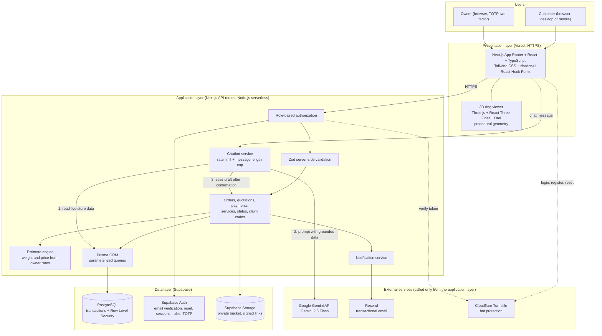
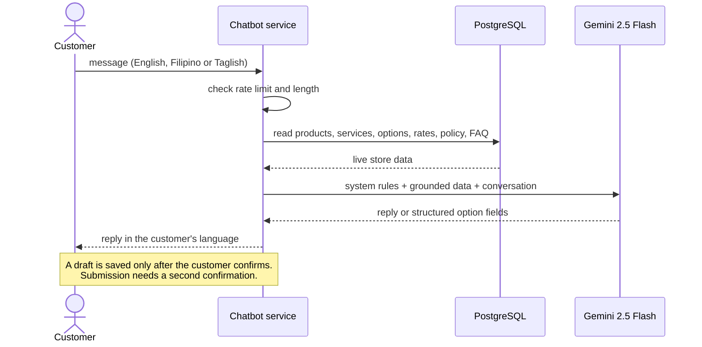

# Architecture

Source: manuscript Section 3.10 and Figure 5, with the grill-me decisions applied. The diagram is redrawn from the text, not copied from the manuscript image.

AURELIUS is a serverless three-tier web application with third-party cloud services. It separates the interface, application logic, external services, and data storage. It suits a small owner-run store with no IT staff.

## Figure 5. System architecture



## Layers

### Presentation layer

- React and TypeScript inside Next.js (App Router). Styled with Tailwind CSS and shadcn/ui.
- Three.js, React Three Fiber and Drei render the ring viewer. The model is generated in code from parameters (ring style, metal, color, stones, size) and updates on each option change. There are no stored model files.
- React Hook Form handles order, quotation and service forms.
- Hosted on Vercel over HTTPS with automatic deploys from GitHub.

### Application layer

- Next.js API routes on Node.js, run as serverless functions.
- Enforces role-based authorization. Price confirmation, design approval, payment verification and refund recording are owner-only.
- Computes the estimated weight and price from the owner's rates and saves an itemized snapshot on submission and on each quotation.
- Validates all input with Zod before saving. Prisma uses parameterized queries.
- Runs the chatbot. Each turn reads live products, services, option lists and rates, the refund policy and the owner-editable Store Information and FAQ from the database. It passes the relevant parts to Gemini. This is grounding with retrieval from the store's database, not full RAG with embeddings.
- Keeps all API keys on the server.
- Runs scheduled jobs: reservation expiry, quotation expiry, unclaimed-item reminders, owner daily digest.

### External services

| Service                              | Purpose                                                                                                         |
| ------------------------------------ | --------------------------------------------------------------------------------------------------------------- |
| Google Gemini API (Gemini 2.5 Flash) | Chatbot. Answers only from approved store data. No final prices. Refers out-of-scope inquiries to the owner.    |
| Resend                               | Customer emails (quotations, status changes, ready for claiming, claim code) and owner alerts and daily digest. |
| Cloudflare Turnstile                 | Bot protection on login, registration and password reset.                                                       |

### Data layer

- Supabase PostgreSQL stores customers, products, orders, quotations, payments and service requests. Transactions keep balances correct. Row Level Security limits each customer to their own records.
- Supabase Auth handles email verification, password reset, sessions and roles. The owner role is set in the database at handover. It cannot be written from the client. The owner account requires TOTP.
- Supabase Storage holds proof-of-payment files (JPG, PNG, PDF, up to 5 MB) and owner in-store photos (JPG, PNG, up to 5 MB) in a private bucket. Access is by short-lived signed links.
- All requests to this layer come from the application layer.

## Code structure

The Maintainability NFR asks for code organized by the four modules plus shared and admin areas. Under `src/`, the `app/` folder holds routes only. Each module owns its screens, components, server logic and types. Create a module folder when its first file arrives, not before.

```text
src/
  app/                 Next.js routes and layouts. No business logic.
  modules/
    customization/     3D ring viewer, options, estimate engine
    ecommerce/         products, ready-made orders, payments, claiming
    services/          service requests, quotations for services
    chatbot/           chat sessions, grounding, Gemini calls
    admin/             owner-only screens and actions
  components/
    ui/                shadcn/ui components, restyled to DESIGN.md (Base UI)
    store/             store-specific shared components (Wordmark, SiteShell, StatusBadge)
  config/              brand.ts (store name), fonts.ts (typefaces, one file)
  lib/                 utils.ts (cn helper, generated by shadcn)
  shared/              used by two or more modules
    env.ts             Zod parsing of environment variables (pure, testable)
    env.server.ts      server-only getServerEnv()
    status.ts          status vocabularies and labels
    db/prisma.ts       server-only Prisma client (driver adapter)
    supabase/          browser.ts and server.ts client helpers
  generated/prisma/    generated Prisma client. Git-ignored.
prisma/schema.prisma   data model, from 03-erd.md
prisma7.config.ts      Prisma CLI configuration
```

Rules:

- A module imports from `shared/` and from its own folder. It does not import from another module. Cross-module needs go through `shared/` or a route.
- `app/` imports from modules. Modules never import from `app/`.
- Anything that reads a secret imports `server-only` (`env.server.ts`, `db/prisma.ts`, `supabase/server.ts`). Client code reads only `NEXT_PUBLIC_` values through `getPublicEnv()`.
- Environment values are validated on first use, never at import, so the build runs without secrets.
- The `@/` alias points to `src/`.
- The Prisma client is generated by `pnpm install` (`postinstall`) or `pnpm db:generate`. Migrations are not applied yet because there is no database.

## Environments

| Environment                | Hosting                                    | Purpose                                                                                                                  |
| -------------------------- | ------------------------------------------ | ------------------------------------------------------------------------------------------------------------------------ |
| Development and evaluation | Free tiers                                 | Building, testing, respondent evaluation. Cannot meet backup and uptime targets on a free Supabase plan (N36, **Open**). |
| Production (handover)      | Vercel Pro, Supabase Pro, paid Gemini plan | Live store. Accounts are transferred to the owner (N34, N70). Verify provider terms before stating them (N35).           |

## Chatbot turn


