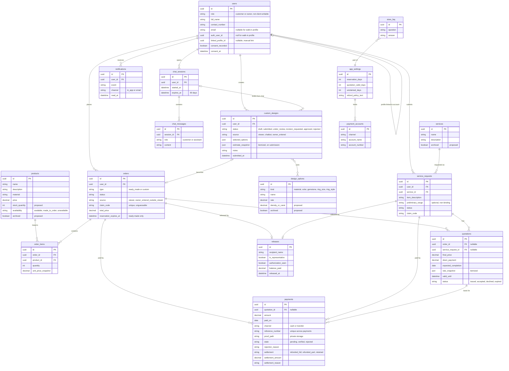

# Entity Relationship Diagram

Source: manuscript Section 3.11 and Figure 6. The diagram is redrawn from the text and extended with the grill-me decisions. Entities and fields marked _(proposed)_ come from the decision notes, not from the manuscript. Field lists are a starting point for the Prisma schema, not final.

## Figure 6. ERD

## Design notes

- **Core entities** follow the manuscript: `users`, `custom_designs`, `orders`, `service_requests`, `chat_sessions`, `notifications`, `products`, `design_options`, `services`, `order_items`, `quotations`, `payments`.
- **Walk-in profiles (N30).** A `users` row with no `auth_user_id` is an owner-created profile. The owner links it to a later account manually (N33). The role field is set only on the server, and Row Level Security blocks customers from changing it (N67).
- **Snapshots (N79).** `estimate_snapshot` and `rate_snapshot` freeze the itemized estimate and rates at submission and at quotation. Later rate changes do not alter them.
- **Archive, not delete (N81).** `archived` flags on `products`, `design_options` and `services` keep history readable.
- **Payments.** A `reference_number` cannot repeat across payments (N22). A zero down payment creates no payment row (N29).
- **Release (N86).** `releases` records who received an item, when, and the balance paid. The system warns when the balance is not zero.
- **Chat (N53).** Transcripts are linked to the customer and expire after 90 days (proposed).
- **Drafts (N11).** A draft has status `draft` and is visible only to its customer.
- **Open:** Row Level Security rules for archived records (N84). Draft retention (N13). Whether `payments` allows a reference number again after a rejected proof (N24).
