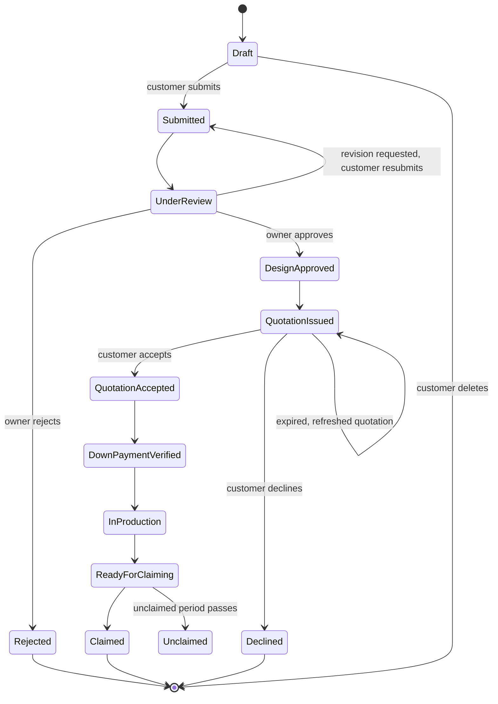
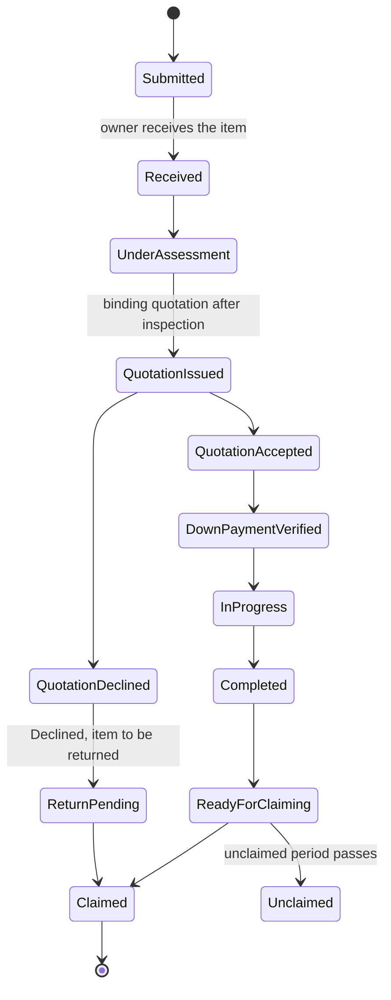
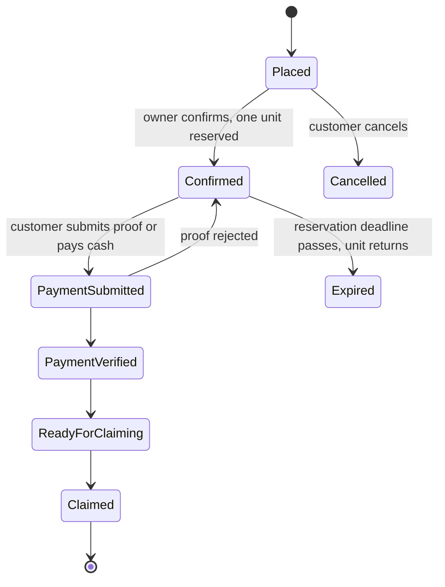
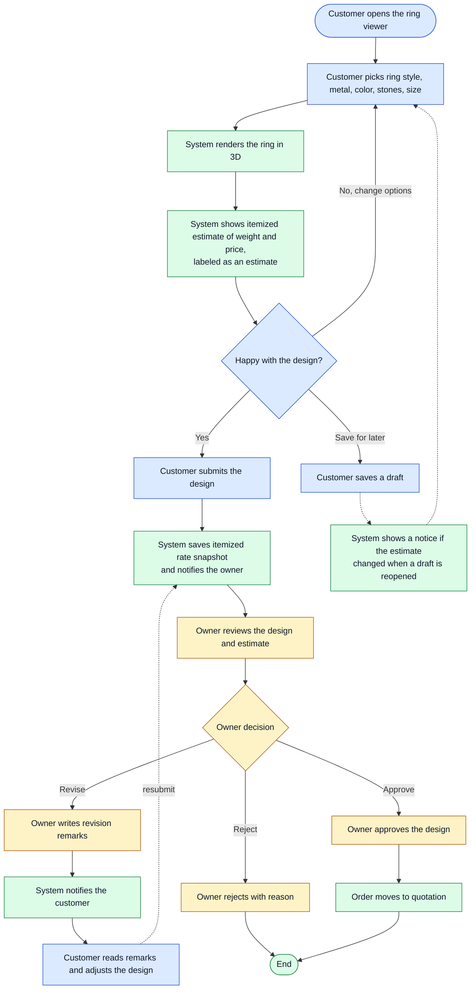
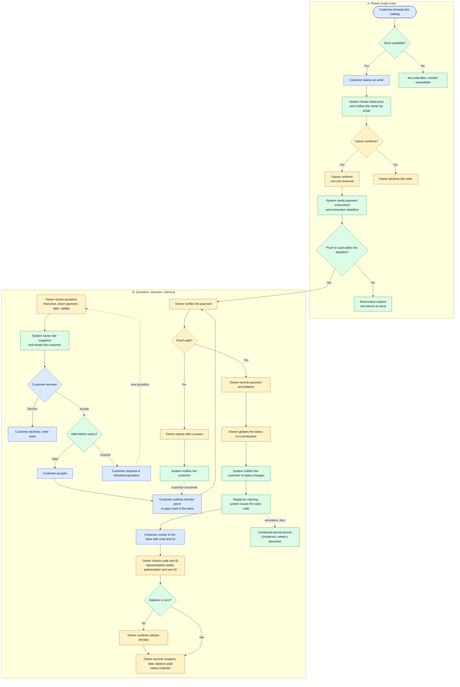
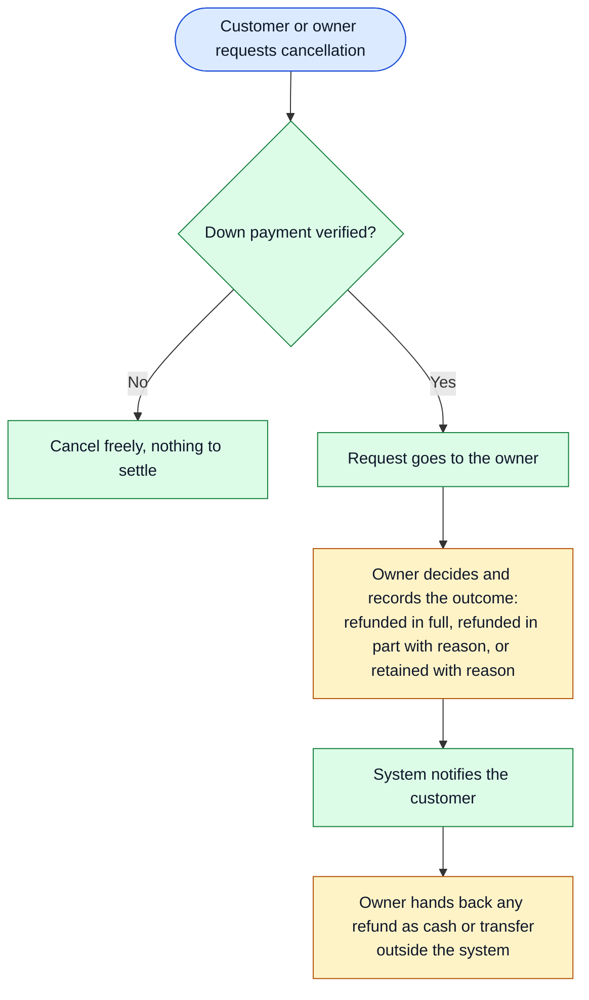
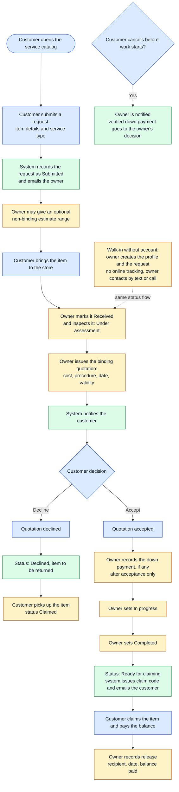
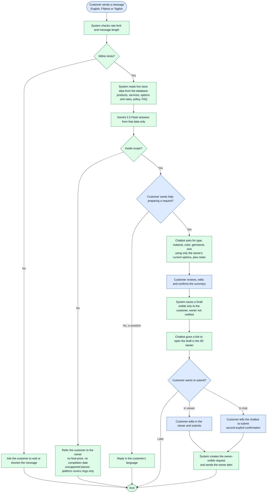
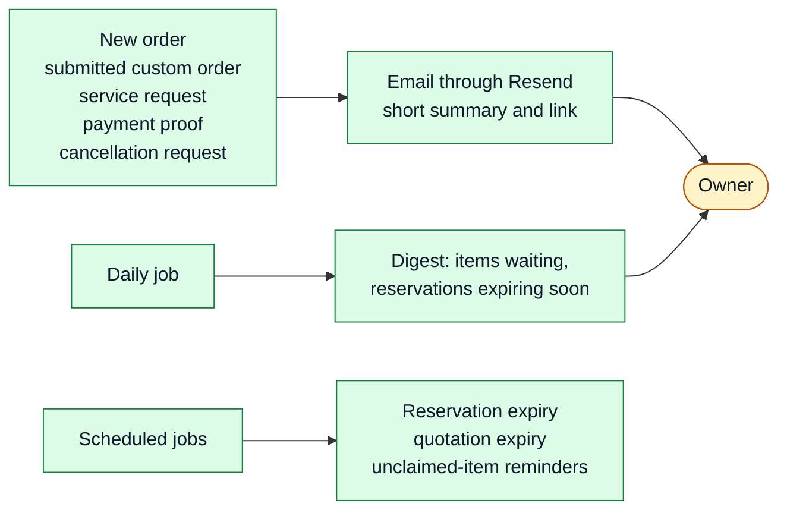

# System Flowcharts

Source: manuscript Section 3.12 (Figures 7 to 10), redrawn from the text and updated with the grill-me decisions. They are not copies of the manuscript images.

Colors show who acts: **blue** is the customer, **green** is the system, **amber** is the owner. Decisions use the color of the actor who decides. Dashed arrows are return paths.

## Status lifecycles

### Custom order (viewer design)

### Service request

### Ready-made order

The status sequence is not defined yet (N45, **Open**). This is a proposal.

## Figure 7. 3D Design Customization

## Figure 8. E-Commerce

Part A covers ready-made products. Part B covers the quotation, payment and claiming steps shared by custom orders, owner-entered orders and services.

### Cancellation and settlement

## Figure 9. Service Management

## Figure 10. AI Chatbot

The service-request draft flow (FR-37) is assumed to follow the same draft-then-submit pattern. Confirm it (N14, **Open**).

## Owner alerts and scheduled jobs

