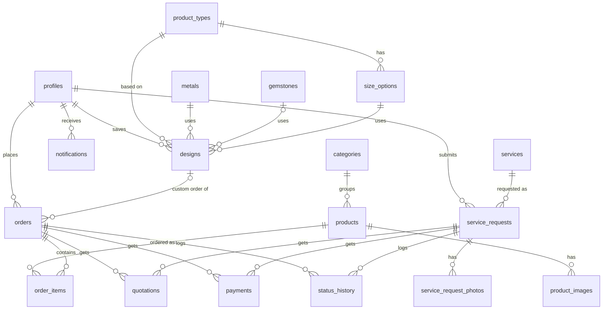

# Sprint 0 — Plan and Database Design (DRAFT, awaiting approval)

> Status: proposal only. Nothing here has been built.
> `docs/requirements.md` does not exist yet, so FR-41 to FR-46 are mapped from the project brief.
> Check the mapping in section 4 against the real requirements.

---

## 1. Create the Next.js project

- `create-next-app` with App Router, TypeScript, Tailwind, ESLint, `src/` folder, `@/*` import alias.
- Extra tools: **Vitest** for unit tests and **Playwright** for one end-to-end auth test.
- Folder layout:

```
src/
  app/
    (public)/          home, catalog, services, login, register, privacy
    account/           customer-only pages
    admin/             owner-only pages
    auth/confirm/      handles email links (verify, password reset)
  lib/
    supabase/          browser.ts, server.ts, middleware.ts
    pricing/           estimate.ts (preview of the price formula)
  components/
supabase/
  migrations/          one SQL file per database change (version-controlled)
  seed.sql             sample metals, sizes, services for development
  tests/               RLS tests
docs/
```

**⚠ Folder location:** the project is inside OneDrive. OneDrive will try to sync `node_modules`
(tens of thousands of files), which slows everything and can lock files during installs.
I recommend moving the project to e.g. `C:\dev\aurelius` and using GitHub as the backup instead.

## 2. Connect to Supabase

- Package `@supabase/ssr` with three clients:
  - **browser client** (anon key only) for client components,
  - **server client** (reads the user's cookie) for server components and server actions,
  - **middleware** that refreshes the login session on every request and redirects:
    not logged in → `/login`; not owner on `/admin/*` → home.
- The middleware redirect is only for user experience. **RLS is the real protection.**
- `.env.local` (git-ignored): `NEXT_PUBLIC_SUPABASE_URL`, `NEXT_PUBLIC_SUPABASE_ANON_KEY`,
  `SUPABASE_SERVICE_ROLE_KEY` (server only, used by very few admin scripts), later `ANTHROPIC_API_KEY`.
  A committed `.env.local.example` lists the names with no values.
- Database changes are made only through files in `supabase/migrations/`, never by clicking in the
  dashboard, so every change is reviewable and repeatable.
- Generated TypeScript types: `supabase gen types typescript` → `src/lib/supabase/database.types.ts`.

## 3. Database design (all modules)

### 3.1 Shared types

```sql
create type user_role      as enum ('customer', 'owner');
create type request_status as enum ('pending', 'quoted', 'down_payment_received',
                                    'in_progress', 'ready_for_claiming', 'completed', 'cancelled');
create type payment_status as enum ('submitted', 'verified', 'rejected');
create type payment_method as enum ('gcash', 'bank_transfer', 'cash');
create type payment_kind   as enum ('down_payment', 'balance', 'full');
create type quote_status   as enum ('sent', 'accepted', 'declined', 'expired');
```

Allowed status moves, enforced by a database trigger (not just the UI):

```
pending ─► quoted ─► down_payment_received ─► in_progress ─► ready_for_claiming ─► completed
   └──────────┴──────────────┴───────────────────┴──────────► cancelled
```

Any move not on this diagram is rejected with a clear error message.

### 3.2 Tables

**Accounts and admin (FR-41 to FR-50)**

| Table | Key columns | Notes |
|---|---|---|
| `profiles` | `id` (PK, = `auth.users.id`), `full_name`, `phone`, `role` (default `customer`), `privacy_notice_version`, `privacy_accepted_at`, `created_at`, `updated_at` | Created automatically by a trigger at signup. Email lives in `auth.users` only, not copied. A unique partial index allows **only one** `owner`. |
| `store_settings` | single row: `store_name`, `address`, `business_hours`, `gcash_name`, `gcash_number`, `bank_details`, `down_payment_percent` | Shown on payment pages and used by the chatbot. |
| `notifications` | `id`, `user_id` → profiles, `title`, `body`, `link`, `is_read`, `created_at` | Realtime enabled. Inserted by triggers when a status, quote or payment changes. |

**Rates (FR-47) and 3D customization (FR-01 to FR-11)**

| Table | Key columns | Notes |
|---|---|---|
| `metals` | `id`, `name` (e.g. "18K Yellow Gold"), `rate_per_gram`, `density_ratio`, `is_active`, `updated_at` | Owner-set. Used in the price formula. |
| `gemstones` | `id`, `name`, `size_label`, `price`, `mesh_color`, `is_active` | Owner-set. |
| `product_types` | `id`, `name` (ring, pendant, bracelet…), `model_path` (Storage .glb), `base_weight_g`, `labor_fee`, `is_active` | One .glb per type. |
| `size_options` | `id`, `product_type_id` → product_types, `label` (e.g. "US 7"), `size_factor` | |
| `designs` | `id`, `customer_id` → profiles, `name`, `product_type_id`, `metal_id`, `gemstone_id` (nullable), `size_option_id`, `engraving_text`, `est_weight_g`, `est_price`, `rates_snapshot` (jsonb), `created_at` | Saved customizations. **`est_weight_g` and `est_price` are calculated by a database trigger from current rates** — the browser can't send a fake price. The snapshot records the rates used, so later rate changes don't alter an old estimate. |

**E-commerce (FR-12 to FR-24)**

| Table | Key columns | Notes |
|---|---|---|
| `categories` | `id`, `name`, `sort_order` | |
| `products` | `id`, `category_id`, `name`, `description`, `price`, `weight_g`, `metal_id` (nullable), `stock_qty`, `is_active`, `created_at` | Ready-made items and watches. |
| `product_images` | `id`, `product_id`, `storage_path`, `sort_order` | |
| `orders` | `id`, `order_number` (e.g. `ORD-2026-00012`), `customer_id`, `order_type` (`catalog` / `custom`), `design_id` (nullable), `status`, `customer_notes`, `submitted_at`, `created_at`, `updated_at` | Pick-up at the store ("ready for claiming"), no delivery. |
| `order_items` | `id`, `order_id`, `product_id`, `quantity`, `unit_price` | `unit_price` copied from `products` by trigger. |

**Service management (FR-25 to FR-34)**

| Table | Key columns | Notes |
|---|---|---|
| `services` | `id`, `name` (battery replacement, resizing, cleaning, repair…), `description`, `starting_price`, `typical_duration_text`, `is_active` | Prices shown as "starting from", not binding. |
| `service_requests` | `id`, `request_number` (`SRV-2026-00007`), `customer_id`, `service_id`, `item_description`, `issue_description`, `status`, `source` (`web` / `chatbot`), `submitted_at` (null = draft), `created_at`, `updated_at` | **A draft is a row with `submitted_at = null`.** The chatbot can only create drafts; the customer reviews and submits (FR-40). The owner never sees drafts. |
| `service_request_photos` | `id`, `service_request_id`, `storage_path` | |

**Shared by orders and service requests**

Each of these has `order_id` *or* `service_request_id`, with a check that exactly one is filled. This
keeps real foreign keys and one shared flow instead of two copies.

| Table | Key columns | Notes |
|---|---|---|
| `quotations` | `id`, `order_id` / `service_request_id`, `total_amount`, `down_payment_amount`, `estimated_completion_text`, `valid_until`, `owner_notes`, `status`, `created_at` | Owner creates; customer accepts/declines. Creating one moves the job to `quoted`. |
| `payments` | `id`, `order_id` / `service_request_id`, `kind`, `method`, `amount`, `reference_number`, `receipt_path`, `status`, `reject_reason`, `verified_at`, `created_at` | Customer uploads GCash/bank reference + screenshot; owner verifies. Owner can also record cash paid in the store. |
| `status_history` | `id`, `order_id` / `service_request_id`, `from_status`, `to_status`, `changed_by`, `note`, `created_at` | Written by trigger on every status change. Drives the tracking timeline. |

**Chatbot (FR-35 to FR-40)**

| Table | Key columns | Notes |
|---|---|---|
| `kb_articles` | `id`, `title`, `content`, `category`, `is_published`, `updated_at` | The only source the bot may answer from. Owner edits. |

Chat transcripts: **not stored in Sprint 0.** Storing them means storing personal data; we decide
in the chatbot sprint whether we need them (see open questions).

### 3.3 Relationships (ER diagram)



### 3.4 Row Level Security rules

RLS is **on for every table**. Helper: `is_owner()` returns true when the logged-in user's profile
has role `owner` (a `security definer` function so policies don't loop on `profiles`).

| Table(s) | Customer | Owner | Public (not logged in) |
|---|---|---|---|
| `profiles` | read/update **own** row; may update only `full_name`, `phone` (column privileges) | read all | — |
| `metals`, `gemstones`, `product_types`, `size_options`, `categories`, `products`, `product_images`, `services` | read active rows | full access | read active rows |
| `store_settings` | read | update | read |
| `kb_articles` | read published | full access | read published |
| `designs` | create/read/update/delete **own** | read all | — |
| `orders`, `service_requests` | create own (status forced to `pending`); read own; edit own **drafts** only; cancel own via `cancel_request()` function while `pending`/`quoted` | read all **submitted**, change status (trigger checks the move is allowed) | — |
| `order_items`, `service_request_photos` | read/add for own parent while it is a draft/pending | read all | — |
| `quotations` | read own; accept/decline via `respond_to_quotation()` function | create/update | — |
| `payments` | create for own job (status forced to `submitted`); read own | read all; verify/reject | — |
| `status_history` | read own | read all | — (written only by trigger) |
| `notifications` | read own; mark own as read | read own | — (written only by triggers) |

**Storage buckets**

| Bucket | Access |
|---|---|
| `models` (.glb, ≤ 5 MB) | public read, owner write |
| `product-images` | public read, owner write |
| `receipts` (private) | files saved as `{user_id}/…`; customer uploads/reads own folder; owner reads all |
| `service-photos` (private) | same rule as `receipts` |

**Why some actions go through functions instead of plain updates:** RLS decides *which rows* you
can change, not *how*. Cancelling, accepting a quote and status moves need rules about the current
status, so they live in database functions/triggers that check the rule and give a clear error.

## 4. Accounts: FR-41 to FR-46 (mapping assumed — please confirm)

| FR (assumed) | Feature | How |
|---|---|---|
| FR-41 | Registration | Form: full name, email, mobile number, password, privacy checkbox. Clear field-level errors. |
| FR-42 | Email verification | Supabase sends a link → `/auth/confirm` checks it → account active. Unverified users can't log in (message explains and offers "resend email"). |
| FR-43 | Login / logout | Email + password. Wrong password message doesn't reveal whether the email exists. |
| FR-44 | Password reset | "Forgot password" → email link → `/auth/confirm` → set new password page. |
| FR-45 | Privacy notice | `/privacy` page (Data Privacy Act of 2012: what we collect, why, how long, rights, contact). Registration **can't complete** without accepting: the signup trigger rejects it if acceptance is missing, and stores version + time. |
| FR-46 | Profile management | Customer edits name and phone; can request account deletion (owner handles). |

**Email sending:** Supabase's built-in email sender allows only a few emails per hour and is for
testing only. Before the defense/demo we'll need custom SMTP (e.g. Resend's free tier).

## 5. Owner / admin role

- Every new account is a `customer`. There is **no way to sign up as owner** from the app.
- The owner account is promoted once with a SQL script run by you in the Supabase SQL editor
  (`update profiles set role = 'owner' where id = …`).
- The database allows only one owner (unique partial index), matching "single-owner store".
- Customers can't change their own role: the `role` column isn't in their update privileges.
- `/admin` pages check the role on the server; RLS blocks owner-only data even if a page check is missed.
- Sprint 0 delivers an empty `/admin` dashboard shell; real admin screens come with each module.

## 6. Tests for Sprint 0

- **Unit (Vitest):** form validation, price-formula preview (`estimate.ts`) with known values and rounding.
- **RLS tests:** customer A can't read B's profile, designs, orders, receipts; customer can't make
  themselves owner; customer can't set a status or a price; public users see only active catalog rows;
  signup without privacy acceptance fails; a forbidden status move fails.
- **End-to-end (Playwright):** register → verify (local email inbox) → log in → reset password.

## 7. Build order (each step: build → test → commit → explain)

1. Next.js project scaffold
2. Supabase connection + middleware
3. Migration 1: types, `profiles`, signup trigger, `is_owner()`, RLS → auth pages (FR-41 to FR-46)
4. Owner role + `/admin` shell
5. Migration 2: all remaining tables and RLS from section 3 (empty, with seed data)
6. RLS test suite

Migration 2 creates the full schema now so the design is fixed and tested early; later sprints add
screens, not tables. Small changes will still come as new migration files.

## 8. Decisions needed from you

1. **Supabase setup:** local (Supabase CLI + Docker Desktop, free, best for tests) **or** hosted
   project only? Recommended: local for development + a hosted project for the demo.
2. **Folder:** move the project out of OneDrive?
3. **Requirements file:** please add `docs/requirements.md` so I can confirm the FR mapping.
4. **Chat transcripts:** store them (with a retention limit) or not at all? Can wait until the chatbot sprint.
